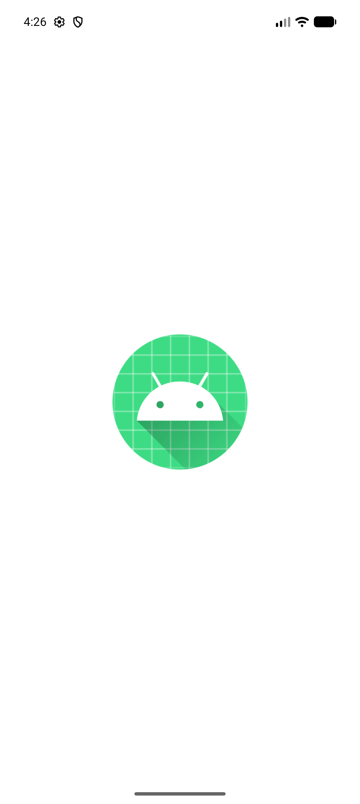
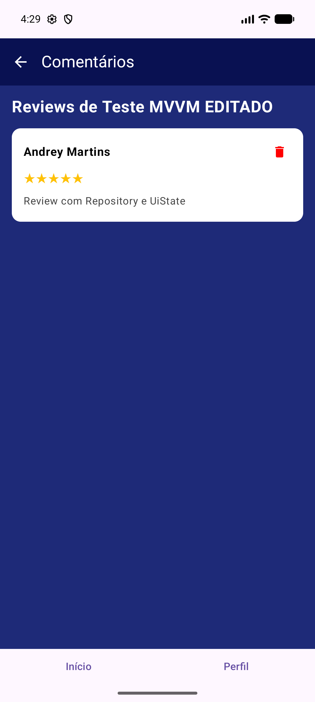
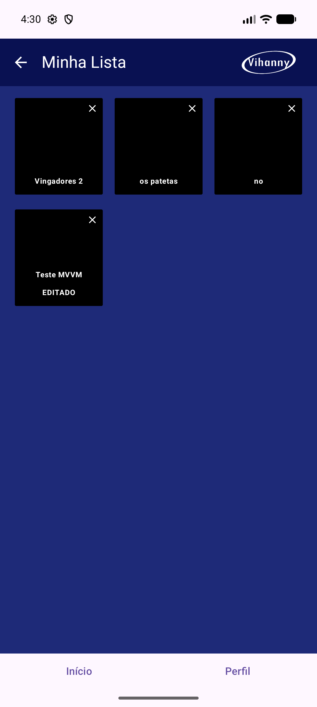
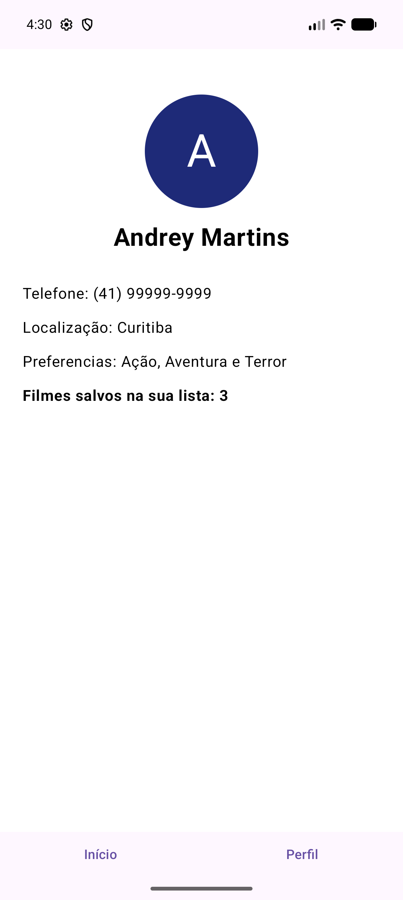
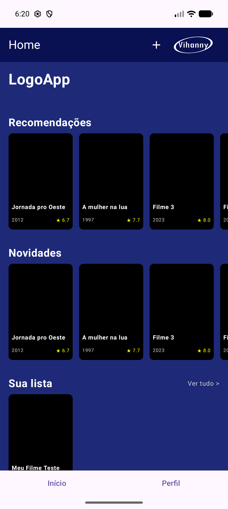
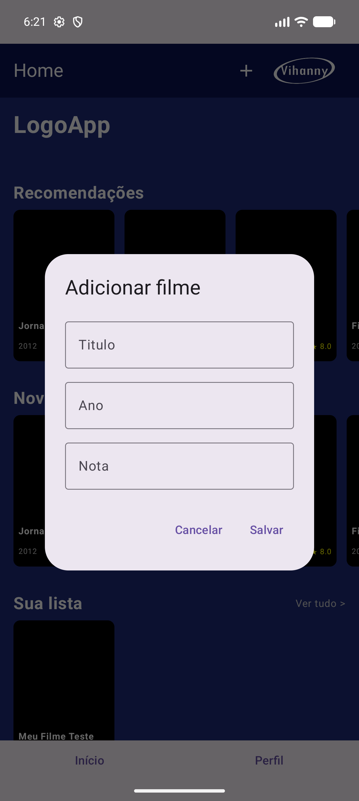
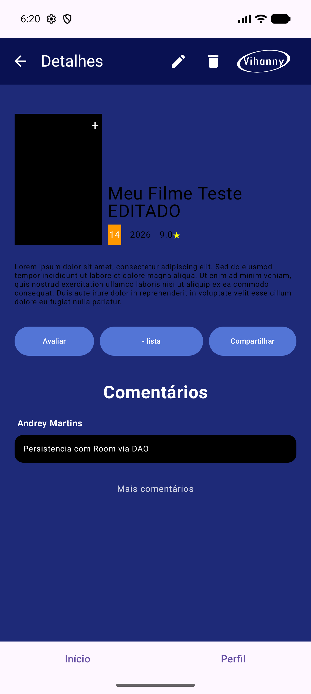
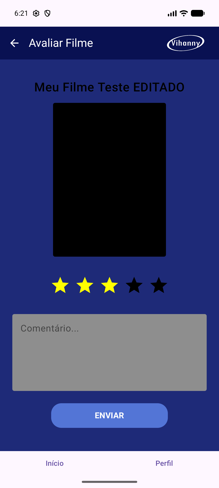
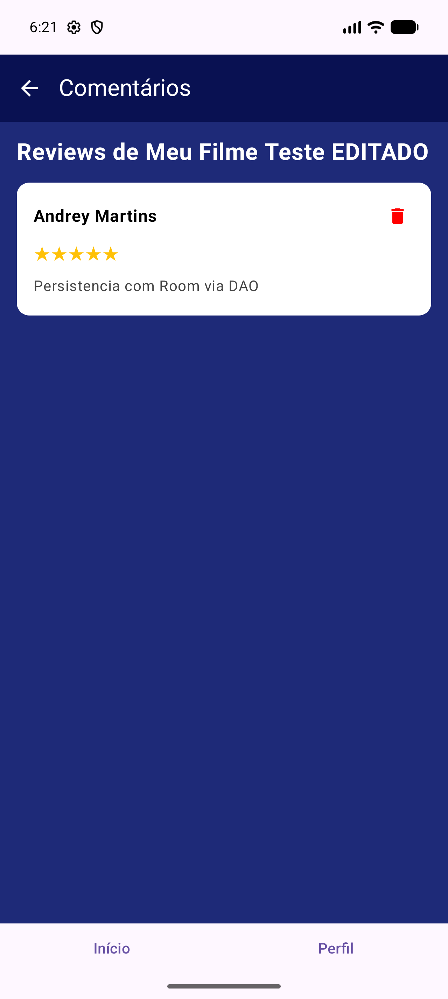
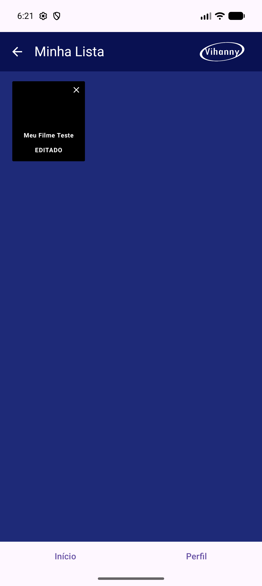

# 📱 myStreaming — Documentação do Projeto Mobile (Quarta Entrega)

> **Trabalho 4 — Refatoração para MVVM (Model — View — ViewModel).**
> O Trabalho 3 resolveu a **persistência** (Room). Este trabalho resolve a **organização**:
> as mesmas telas, os mesmos dados, as mesmas funcionalidades — agora em camadas bem definidas.

---

## 📖 Índice

1. [Como rodar o projeto](#-como-rodar-o-projeto)
2. [O que é este trabalho (em 1 minuto)](#-o-que-é-este-trabalho-em-1-minuto)
3. [Como estava no Trabalho 3 e o que mudou](#-como-estava-no-trabalho-3-e-o-que-mudou)
4. [Como dividimos os pacotes](#-como-dividimos-os-pacotes)
5. [Por que o Repository existe](#-por que-o-repository-existe)
6. [O DAO reativo com Flow](#-o-dao-reativo-com-flow)
7. [O UiState de cada tela](#-o-uistate-de-cada-tela)
8. [ViewModelFactory: como o Repository chega no ViewModel](#-viewmodelfactory-como-o-repository-chega-no-viewmodel)
9. [O que quebrou durante a reorganização](#-o-que-quebrou-durante-a-reorganização)
10. [Prova de que nada quebrou (testes)](#-prova-de-que-nada-quebrou-testes)
11. [Dificuldades de cada integrante](#-dificuldades-de-cada-integrante)
12. [Checklist de entrega](#-checklist-de-entrega)
13. [Histórico das entregas anteriores](#-histórico-das-entregas-anteriores)

---

## 🚀 Como rodar o projeto

**Requisitos:** Android Studio (Ladybug+), JDK 17 ou superior, Android SDK 35+ (o projeto usa `compileSdk 37`),
emulador ou aparelho com **API 29+**.

```bash
# 1. Sincronizar o Gradle e compilar
./gradlew.bat :app:assembleDebug      # Windows
./gradlew :app:assembleDebug          # Linux/macOS

# 2. Instalar no dispositivo
adb install -r app/build/outputs/apk/debug/app-debug.apk

# 3. Abrir
adb shell am start -n com.example.mystreaming/.MainActivity
```

Ou, simplesmente, abra a pasta no **Android Studio**, clique em *Sync Now* e depois em **Run ▶**.

> ⚠️ O banco `mystreaming.db` fica no armazenamento interno do app. Para começar do zero:
> `adb shell pm clear com.example.mystreaming`. Para provar a persistência, use
> `adb shell am force-stop com.example.mystreaming` — que apenas fecha o app.

---

## 🎯 O que é este trabalho (em 1 minuto)

No Trabalho 3 o app **funcionava**, mas o código era " bagunçado de propósito":

- o `@Composable` **falava direto com o `@Dao`**;
- cada tela criava a **própria `CoroutineScope`** e usava `Dispatchers.IO` dentro do componente;
- o estado de cada tela vivia espalhado em várias `var ... by remember`;
- um `MainViewModel` gigante (133 linhas) concentrava as três listas e todos os métodos;
- depois de cada `inserir`/`deletar`, era preciso **buscar os dados de novo na mão** — a lista podia
  ficar dessincronizada.

> *"Funciona, mas cresce mal: quanto mais telas e regras o projeto ganha, mais difícil fica mexer em
> uma parte sem quebrar outra."* — enunciado do Trabalho 4

**Este trabalho não cria nada.** Ele reorganiza o que já existe em quatro camadas:

```
┌──────────────────────────────────────────────────────────────┐
│  ui  (View)                                                   │
│  screens/  components/  navigation/                          │
│  • só lê o uiState e chama métodos do ViewModel               │
│  • ZERO dao, ZERO CoroutineScope, ZERO Dispatchers.IO        │
└───────────────┬──────────────────────────────┬───────────────┘
                │ StateFlow<UiState>           │ chamadas de ação
                ▼                              ▼
┌──────────────────────────────────────────────────────────────┐
│  viewmodel                                                    │
│  FilmesViewModel + FilmesUiState                             │
│  ReviewsViewModel + ReviewsUiState                           │
│  FilmesViewModelFactory / ReviewsViewModelFactory             │
└───────────────┬──────────────────────────────┬───────────────┘
                │ só o ViewModel fala com o Repository
                ▼                              ▼
┌──────────────────────────────────────────────────────────────┐
│  data.repository                                              │
│  FilmesRepository (FilmesDao)  ReviewsRepository (ReviewsDao) │
│  SeedRepository (popula o banco)  RepositoryProvider (ServiceLocator) │
└───────────────┬──────────────────────────────┬───────────────┘
                ▼                              ▼
┌──────────────────────────────────────────────────────────────┐
│  data.local  (Model — Room)                                   │
│  MediaItem.kt  Review.kt  (Entities)                         │
│  FilmesDao.kt ReviewsDao.kt  (DAOs — buscarTodos = Flow)     │
│  AppDatabase.kt (Singleton)  DadosDeExemplo.kt (seed)         │
└──────────────────────────────────────────────────────────────┘
```

**A regra de ouro:** a seta só aponta para baixo. Nenhum arquivo de `ui` importa `androidx.room3.*`,
`data.local.*` nem `Dispatchers`.

---

## 🔄 Como estava no Trabalho 3 e o que mudou

| | **Trabalho 3** | **Trabalho 4 (agora)** |
|---|---|---|
| Quem fala com o `@Dao` | o `MainViewModel` (e a tela puxava o estado dele) | **só o `Repository`** |
| Telas | `@Composable` com `rememberCoroutineScope()` + `launch(Dispatchers.IO)` | `@Composable` que **só lê `uiState` e chama o ViewModel** |
| Estado da tela | 3 a 6 `var ... by remember` por tela | **um `UiState` por ViewModel** (lista, item em foco, carregando, erro, formulário, diálogos) |
| ViewModels | 1 `MainViewModel` gigante, com `StateFlow` por lista | **2 ViewModels**, cada um com `_uiState` privado + `uiState` público |
| Como a tela recebia o ViewModel | `viewModel()` (sem injeção) | `viewModel(factory = FilmesViewModelFactory(repository))` |
| Listas depois de uma escrita | `carregarFilmes()` chamado "na mão" | **o Room reemite o `Flow` e a tela atualiza sozinha** |
| Dependências do DAO | dentro do ViewModel | isoladas no `Repository` (trocar a fonte de dados não afeta mais nada) |
| Onde o DAO vivia | `com.example.mystreaming.data` | `com.example.mystreaming.data.local` |

### Antes × depois, no mesmo lugar do código

**Antes (Trabalho 3) — a tela fazia tudo:**

```kotlin
@Composable
fun HomeScreen(mainViewModel: MainViewModel) {
    val scope = rememberCoroutineScope()
    var titulo by remember { mutableStateOf("") }
    var mostrarFormulario by remember { mutableStateOf(false) }

    LaunchedEffect(Unit) {
        scope.launch(Dispatchers.IO) {
            try {
                mainViewModel.carregarFilmes()
            } catch (e: Exception) {
                Log.e("HomeScreen", "Erro ao carregar os filmes do banco", e)
            }
        }
    }

    Button(onClick = {
        scope.launch(Dispatchers.IO) {
            try {
                mainViewModel.inserirFilme(MediaItem(title = titulo, ...))
            } catch (e: Exception) {
                Log.e("HomeScreen", "Erro ao salvar o filme", e)
            }
        }
    }) { Text("Salvar") }
}
```

**Depois (Trabalho 4) — a tela só desenha e delega:**

```kotlin
@Composable
fun HomeScreen(viewModel: FilmesViewModel) {
    // 1. COLETAR o que desenhar
    val uiState by viewModel.uiState.collectAsStateWithLifecycle()

    // 2. CHAMAR o ViewModel quando o usuário interage
    Button(onClick = { viewModel.adicionarFilme() }) { Text("Salvar") }
}
```

> ✂️ O que **sumiu** de todas as telas: `rememberCoroutineScope()`, `launch(Dispatchers.IO)`,
> `try/catch` com `Log.e`, as chamadas `carregarX()` e todas as `var ... by remember` de estado de tela.

---

## 📦 Como dividimos os pacotes

```
app/src/main/java/com/example/mystreaming/
├── MainActivity.kt                    ← ponto de entrada do Android (fica na raiz de propósito)
├── data/
│   ├── local/                         ← MODEL: o Room (Entity, DAO, Database, seed)
│   │   ├── MediaItem.kt      Review.kt
│   │   ├── FilmesDao.kt      ReviewsDao.kt
│   │   └── AppDatabase.kt    DadosDeExemplo.kt
│   └── repository/                    ← o Repository: a única porta de entrada para o banco
│       ├── FilmesRepository.kt
│       ├── ReviewsRepository.kt
│       ├── SeedRepository.kt
│       └── RepositoryProvider.kt      (ServiceLocator: entrega as instâncias)
├── viewmodel/                         ← VIEWMODEL: estado da tela + regras
│   ├── FilmesUiState.kt      FilmesViewModel.kt
│   ├── ReviewsUiState.kt     ReviewsViewModel.kt
│   └── ViewModelFactory.kt
└── ui/                                ← VIEW: só interface
    ├── AppScreen.kt
    ├── components/                    (MediaCard, ReviewCard, CardComentarioItem)
    ├── navigation/                    (AppNavigation, Rotas)
    └── screens/                       (Home, Detalhes, MinhaLista, Avaliacao, Comentarios, ComentarioDetalhe, Perfil)
```

**Por que cada coisa foi para onde foi**

- **`data.local`** — as `@Entity`, os `@Dao` e o `@Database` **exatamente como já existiam** do Trabalho 3.
  Não mudamos nada aqui dentro (só o `package`), porque essa parte já estava certa: ela é a fonte da
  verdade, e falar com SQLite não é responsabilidade de mais ninguém.
- **`data.repository`** — aqui fica o **Repository**: a única classe autorizada a falar com o `@Dao`.
  Ele traduz "o que a tela quer" em "o que o banco sabe fazer" e é o **único** lugar que precisaria mudar
  se a fonte de dados mudasse.
- **`viewmodel`** — quem guarda o **estado da tela** e quem decide **o que fazer** quando o usuário age.
  Não sabe de SQLite: só conhece o Repository.
- **`ui`** — quem **desenha**. Não tem regra de negócio e não tem `CoroutineScope`. É a camada mais burra
  do projeto, e isso é de propósito: é a que menos vai mudar.
- **`ui/components`** — as peças de interface reaproveitadas (`MediaCard`, `ReviewCard`,
  `CardComentarioItem`). Antes estavam "espremidas" dentro dos arquivos das telas; agora são
  componentes puros, sem saber de ViewModel nem de banco.

> ⚠️ **Uma decisão de risco que TOMAMOS:** o `MainActivity` ficou no pacote raiz (`com.example.mystreaming`)
> em vez de ir para `ui/`. Movê-lo mudaria o FQCN da Activity e exigiria editar o `AndroidManifest.xml`
> (`android:name=".MainActivity"` → `".ui.MainActivity"`) — e um erro ali só apareceria **em runtime**, com
> o app fechando na hora de abrir. Como o enunciado não pede isso, preferimos não arriscar.

### Onde cada tela ficou connected a qual ViewModel

| Tela | ViewModel(s) | Por quê |
|---|---|---|
| **Home** | `FilmesViewModel` | lista de filmes + "Sua lista" + formulário de adicionar |
| **Minha Lista** | `FilmesViewModel` | é a "Sua lista" (mesmo repositório, mesmo estado) |
| **Detalhes** | `FilmesViewModel` + `ReviewsViewModel` | precisa do filme **e** dos comentários dele |
| **Avaliar** | `ReviewsViewModel` | formulário de avaliação + título do filme |
| **Comentários** | `ReviewsViewModel` | comentários do filme + título |
| **Comentário (detalhe)** | `ReviewsViewModel` | um comentário, buscado pelo id |
| **Perfil** | `FilmesViewModel` | só a estatística da "Sua lista" |

> Optamos por **2 ViewModels** (um por Entity), o mínimo do enunciado, em vez de um por tela. Com isso a
> tela de Detalhes é a única que usa dois ViewModels — e ela realmente precisa dos dois.

---

## 🧱 Por que o Repository existe

O Repository é a **única porta de entrada** para o banco. Antes ele não existia, e isso causava três
problemas concretos:

**1. O DAO vazava para cima.**
No Trabalho 3 quem chamava `dao.inserir(...)` era o `MainViewModel`, e quem chamava o `MainViewModel`
era a tela. O `@Dao` era detalhe de implementação do banco aparecendo em todo o caminho.
*Com o Repository:* a tela não sabe que existe SQLite. Se um dia o dado viesse de uma **API**, só o
`FilmesRepository` mudaria — `FilmesViewModel` e a `HomeScreen` continuariam **intactos**.

```kotlin
class FilmesRepository(private val dao: FilmesDao) {
    val filmes: Flow<List<MediaItem>> = dao.buscarTodos()
    val minhaLista: Flow<List<MediaItem>> = dao.buscarDaMinhaLista()

    suspend fun buscarPorId(id: Int): MediaItem? = dao.buscarPorId(id)
    suspend fun inserir(filme: MediaItem): Long = dao.inserir(filme)
    suspend fun atualizar(filme: MediaItem) = dao.atualizar(filme)
    suspend fun deletar(filme: MediaItem) = dao.deletar(filme)
}
```

**2. As regras de banco estavam espalhadas.**
Cada tela que precisasse de "os filmes que o usuário salvou" escrevia a própria query. Com o Repository,
a pergunta é feita **uma vez** (`buscarDaMinhaLista()`) e o significado fica em um lugar só.

**3. O seed não tinha casa.**
Os dados de exemplo precisam inserir **filmes e avaliações juntos** (as avaliações referenciam o id dos
filmes, e a chave estrangeada quebraria se a avaliação entrasse antes do filme). Com um Repository por
Entity, isso não cabia em nenhum dos dois. Criamos então o **`SeedRepository`**, que é o dono do
"popular o banco na primeira execução" — ele recebe os dois DAOs justamente para fazer isso de forma
atômica, e usa um `Mutex` para nunca duplicar o seed.

```kotlin
class SeedRepository(private val filmesDao: FilmesDao, private val reviewsDao: ReviewsDao) {
    private val mutex = Mutex()
    private var semeado = false

    suspend fun popularBancoSeVazio() = mutex.withLock {
        if (semeado) return
        if (filmesDao.buscarTodos().first().isEmpty()) {
            filmesDeExemplo.forEach { filmesDao.inserir(it) }
            reviewsDeExemplo.forEach { reviewsDao.inserir(it) }
        }
        semeado = true
    }
}
```

E o **`RepositoryProvider`** (ServiceLocator) entrega as instâncias para a navegação montar as Factories:

```kotlin
object RepositoryProvider {
    fun filmesRepository(context: Context): FilmesRepository = ...
    fun reviewsRepository(context: Context): ReviewsRepository = ...
    fun seedRepository(context: Context): SeedRepository = ...
}
```

> Escolhemos o **ServiceLocator** em vez de uma classe `Application` de propósito: é o mesmo resultado
> sem precisar mexer no `AndroidManifest.xml` (o mesmo risco de runtime que evitamos com o `MainActivity`).

---

## 🌊 O DAO reativo com Flow

Esta foi a mudança mais concreta do trabalho. No Trabalho 3 o `buscarTodos()` era `suspend` e devolvia
uma `List` — então **cada tela tinha que buscar de novo** depois de cada escrita:

```kotlin
// ANTES (Trabalho 3) — buscar de novo na mão
suspend fun inserirFilme(filme: MediaItem) {
    dao.inserir(filme)
    carregarFilmes()        // ← a tela podia ficar dessincronizada se esquecesse
    carregarMinhaLista()
}
```

Agora o DAO devolve um **`Flow`**, e o Room reemite sozinho sempre que a tabela muda:

```kotlin
// DEPOIS (Trabalho 4)
@Query("SELECT * FROM filmes ORDER BY id")
fun buscarTodos(): Flow<List<MediaItem>>      // ← não é mais suspend: o Flow já é assíncrono

@Query("SELECT * FROM filmes WHERE naMinhaLista = 1 ORDER BY id")
fun buscarDaMinhaLista(): Flow<List<MediaItem>>

@Query("SELECT * FROM reviews WHERE filmeId = :filmeId ORDER BY id")
fun buscarPorFilme(filmeId: Int): Flow<List<Review>>
```

O ViewModel só **observa**:

```kotlin
viewModelScope.launch {
    combine(repository.filmes, repository.minhaLista) { filmes, minhaLista -> filmes to minhaLista }
        .collect { (filmes, minhaLista) ->
            _uiState.update { it.copy(filmes = filmes, minhaLista = minhaLista, carregando = false) }
        }
}
```

**O resultado na prática:** o botão "+ lista" muda de "- lista" para "+ lista" **sozinho**, o filme
novo aparece na lista **sem recarregar a tela**, e o comentário enviado na tela "Avaliar" aparece
sozinho no bloco de comentários da tela de Detalhes. Não existe mais nenhum `carregarX()` espalhado.

> 💡 `buscarPorId` continuou `suspend` (é a busca de uma tela de detalhe, de uso único) — o enunciado só
> exige `Flow` no "buscar todos", e é ele que resolve a reatividade das listas.

---

## 🧾 O UiState de cada tela

Cada ViewModel tem **uma data class de estado** que agrupa **tudo** que as suas telas precisam para se
desenhar — no lugar de várias `remember` soltas.

### `FilmesUiState` (Home, Minha Lista, Detalhes, Perfil)

```kotlin
data class FilmesUiState(
    // ---- listas ----
    val filmes: List<MediaItem> = emptyList(),
    val minhaLista: List<MediaItem> = emptyList(),
    // ---- filme em foco (tela de Detalhes) ----
    val filmeSelecionado: MediaItem? = null,
    // ---- status ----
    val carregando: Boolean = true,
    val erro: String? = null,
    // ---- formulário de adicionar (Home) ----
    val mostrarFormulario: Boolean = false,
    val titulo: String = "",
    val ano: String = "",
    val nota: String = "",
    // ---- edição e exclusão (Detalhes) ----
    val mostrarEdicao: Boolean = false,
    val tituloEdicao: String = "",
    val anoEdicao: String = "",
    val notaEdicao: String = "",
    val mostrarExclusao: Boolean = false
)
```

### `ReviewsUiState` (Detalhes, Avaliar, Comentários, Comentário)

```kotlin
data class ReviewsUiState(
    val reviews: List<Review> = emptyList(),
    val reviewSelecionado: Review? = null,
    val filmeId: Int = 0,
    val tituloFilme: String = "",
    val carregando: Boolean = true,
    val erro: String? = null,
    // ---- formulário de avaliação (Avaliar) ----
    val nota: Int = 3,
    val comentario: String = "",
    val enviando: Boolean = false,
    // ---- edição (Comentário) ----
    val mostrarEdicao: Boolean = false,
    val textoEdicao: String = "",
    val notaEdicao: Int = 3
)
```

**Por que esses campos**

- **As listas** (`filmes`, `minhaLista`, `reviews`) — é o dado que a tela desenha. Vêm do `Flow` do banco.
- **O item em foco** (`filmeSelecionado`, `reviewSelecionado`) — a tela de Detalhes e a de Comentário
  mostram **um** item, e ele também está no `UiState` (é derivado do `Flow`, então nunca fica velho:
  editar, salvar na lista ou excluir atualiza a tela sem "buscar de novo").
- **`carregando` e `erro`** — os dois estados que toda tela precisa: enquanto o `Flow` não emitiu a
  primeira vez, mostramos "Carregando do banco..."; se algo deu errado, mostramos a mensagem.
- **O formulário** (`titulo`, `ano`, `nota`, `comentario`) — o texto que o usuário está digitando é
  **estado da tela**, então mora no `UiState`, e não em `var remember` dentro do componente. É por isso
  que o diálogo de "Adicionar filme" e o de "Editar filme" não perdem o que foi digitado.
- **Os flags de diálogo** (`mostrarFormulario`, `mostrarEdicao`, `mostrarExclusao`) — decidir *se* o
  diálogo está aberto é estado da tela, não estado do componente.

> Um detalhe de projeto: como o estado do formulário mora no ViewModel, o `UiState` é **sobrescrito**
> entre as telas que usam o mesmo ViewModel (por exemplo, o `mostrarEdicao` é do mesmo `FilmesUiState`
> em Home e em Detalhes). Como cada tela tem a **sua própria instância** do ViewModel (o escopo é o
> `NavBackStackEntry`), isso não vaza nada entre elas.

### O padrão `_uiState` / `uiState`

```kotlin
private val _uiState = MutableStateFlow(FilmesUiState())   // privado: só o ViewModel altera
val uiState: StateFlow<FilmesUiState> = _uiState.asStateFlow()   // público: só a tela lê
```

A tela **nunca** escreve no estado — ela só chama **ações**:

```kotlin
fun adicionarFilme() {
    val estado = _uiState.value
    if (estado.titulo.isBlank()) return
    viewModelScope.launch {
        try {
            repository.inserir(MediaItem(title = estado.titulo.trim(), ...))
            _uiState.update { it.copy(mostrarFormulario = false, titulo = "", ano = "", nota = "") }
        } catch (e: Exception) {
            Log.e("FilmesViewModel", "Erro ao salvar o filme", e)
            _uiState.update { it.copy(erro = "Nao foi possivel salvar o filme") }
        }
    }
}
```

---

## 🏭 ViewModelFactory: como o Repository chega no ViewModel

O Android não sabe criar sozinho um `ViewModel` que recebe parâmetros no construtor — por isso cada
ViewModel tem uma **Factory** que injeta o Repository na hora da criação:

```kotlin
class FilmesViewModelFactory(
    private val repository: FilmesRepository,
    private val seedRepository: SeedRepository,
    private val filmeId: Int? = null
) : ViewModelProvider.Factory {

    @Suppress("UNCHECKED_CAST")
    override fun <T : ViewModel> create(modelClass: Class<T>): T {
        if (modelClass.isAssignableFrom(FilmesViewModel::class.java)) {
            return FilmesViewModel(repository, seedRepository, filmeId) as T
        }
        throw IllegalArgumentException("ViewModel desconhecido: ${modelClass.name}")
    }
}
```

E a tela/navegação obtém o ViewModel com ela:

```kotlin
composable(Rotas.DESCRICAO, arguments = listOf(navArgument("filmeId") { type = NavType.IntType })) { entry ->
    val filmeId = entry.arguments?.getInt("filmeId") ?: 0

    val factory = remember(filmesRepository, seedRepository, filmeId) {
        FilmesViewModelFactory(filmesRepository, seedRepository, filmeId)
    }

    DetalhesScreen(
        navController = navController,
        filmesViewModel = viewModel(factory = factory),
        reviewsViewModel = viewModel(factory = reviewsFactory)
    )
}
```

> 💡 O `filmeId` (e o `reviewId`) chegam ao ViewModel **pela Factory**, e não por um `rememberSaveable`
> dentro da tela. Assim o ViewModel já nasce sabendo do que trata — e é ele que busca o item no banco.

---

## 💥 O que quebrou durante a reorganização

A reorganização **não foi só "mover arquivo"**. Estas são as coisas que realmente quebraram no caminho
e como resolvemos:

**1. O `buscarTodos()` deixou de ser `suspend` — e o seed parou de compilar.**
O seed do Trabalho 3 era `if (dao.buscarTodos().isEmpty())`. Com o DAO devolvendo `Flow`, essa linha
não compila mais (`isEmpty()` não existe em `Flow`). A solução foi `.first()`:
`if (dao.buscarTodos().first().isEmpty())`.

**2. O seed não cabia em nenhum Repository.**
O seed insere **filmes e avaliações juntos** — as avaliações guardam o `filmeId` dos filmes, e a chave
estrangeira (`onDelete = CASCADE`) faz o SQLite recusar uma avaliação cujo filme não existe ainda.
Com "um Repository por Entity", nenhum dos dois tinha os dois DAOs. Criamos o **`SeedRepository`**,
que existe justamente para isso: ele recebe os dois DAOs e popula o banco de forma atômica, protegido
por `Mutex` (para duas telas abertas ao mesmo tempo não duplicarem o seed).

**3. O `MainViewModel` inteiro sumiu — e com ele o `androidx.lifecycle.AndroidViewModel`.**
Ele existia só porque precisava do `Application` para abrir o banco. Com o `RepositoryProvider`
(ServiceLocator) quem abre o banco é o provider, e o ViewModel virou `ViewModel()` puro, como pede o
enunciado. Todas as telas que pegavam o `mainViewModel` como parâmetro tiveram que ser reescritas.

**4. O `id` do filme precisa chegar no ViewModel.**
No Trabalho 3 a tela recebia o `filme: MediaItem` **inteiro** pela navegação, então ela já sabia tudo.
No MVVM o ViewModel tem que **buscar** o item — e para isso precisa do `id`, que vem da rota
(`descricao/{filmeId}`). A solução foi a Factory receber o id: `FilmesViewModelFactory(repository, seed, filmeId)`.

**5. O botão "+ lista" não atualizava o texto.**
Esse foi o mais chato. O `filmeSelecionado` era buscado uma vez só (`buscarPorId`), então depois de
salvar/remover o filme da "Sua lista" o botão continuava mostrando "+ lista". A solução foi **derivar o
item em foco do `Flow`**: em vez de buscá-lo uma vez, o ViewModel o obtém da lista que já está
observando — assim ele acompanha o banco sozinho e o botão muda na hora.

**6. Telas que dependiam do "estado do outro ViewModel".**
A tela de Avaliar e a de Comentários precisam do **título** do filme, que mora na tabela `filmes`.
Duas saídas: (a) as telas usarem os dois ViewModels; (b) o `ReviewsViewModel` consultar também o
`FilmesRepository`. Escolhemos **(b)**, porque deixa a tela com **um** ViewModel só e o título dentro
do `ReviewsUiState` (`tituloFilme`).

---

## ✅ Prova de que nada quebrou

O enunciado é claro: *"O app precisa continuar fazendo exatamente o que já fazia no Trabalho 3"*.
Então repetimos **toda** a bateria de testes do Trabalho 3 no emulador:

| # | Teste | Resultado |
|---|---|---|
| 1 | App abre com os 4 filmes do seed | ✅ |
| 2 | **Adicionar** filme (+) | ✅ salva no banco e **aparece sozinho** na "Sua lista" |
| 3 | **Listar** (Home, Minha Lista, Comentários) | ✅ tudo vem do banco |
| 4 | **Editar** filme (✏️) | ✅ título/ano/nota mudam e persistem |
| 5 | **Editar** comentário (✏️) | ✅ texto e nota mudam (4 → 5 estrelas) |
| 6 | **Avaliar** (estrelas + ENVIAR) | ✅ grava e **aparece sozinho** no bloco de comentários |
| 7 | **Excluir** comentário (🗑) | ✅ some da lista |
| 8 | **Excluir** filme (🗑 + confirmação) | ✅ some do app |
| 9 | **Tirar da lista** (✕) | ✅ some da "Sua lista" e o total do Perfil cai de 4 para 3 |
| 10 | Detalhes busca o item **pelo id** | ✅ |
| 11 | **Persistência** (`force-stop` → reabrir) | ✅ título editado, comentário e lista continuam lá |
| 12 | `assembleDebug` + `assembleRelease` + `testDebugUnitTest` | ✅ verdes, sem warnings |

📸 **Prints do Trabalho 4** (o visual é **idêntico** ao do Trabalho 3 — a refatoração não mudou a interface):

**Home — as seções e a "Sua lista" vindas do `uiState`**



**Detalhes — filme e comentários vindos do `uiState`**


**Comentários — lista do `uiState`, com o botão de excluir**



**Minha Lista — grid do `uiState`, com ✕ para tirar da lista**



**Perfil — a estatística vem do `uiState`**



> 🎥 **Vídeo:** gravar um vídeo curto (1–2 min) mostrando o app funcionando **igual** ao Trabalho 3
> (adicionar, editar, avaliar, excluir e o teste de fechar/reabrir) e, de quebra, a **vantagem nova**:
> a lista atualiza sozinha, sem "buscar de novo".

---

## 👥 Dificuldades de cada integrante

> *Espaço para o trio preencher com as histórias reais de cada um — este é o item que só o grupo
> consegue responder com as palavras de vocês.*

- **Integrante 1:** *(preencher)*
- **Integrante 2:** *(preencher)*
- **Integrante 3:** *(preencher)*

---

## 📚 Histórico das entregas anteriores

<details>
<summary><b>Trabalho 3 — persistência com Room (clique para abrir)</b></summary>

No **Trabalho 2** tínhamos navegação real com `NavHost` e listas que aceitavam adicionar e remover
itens, mas tudo guardado **só na memória** (`MutableStateFlow`) — fechava o app e os dados sumiam.
No **Trabalho 3** criamos a camada de dados com Room: 2 `@Entity` (`filmes`, `reviews`), 2 `@Dao`,
`AppDatabase` em Singleton, CRUD completo e persistente, e a Tela de Detalhes passou a buscar o filme
**no banco pelo id** (em vez de receber o objeto pronto pela navegação).

**Prints do Trabalho 3:**








</details>

<details>
<summary><b>Trabalho 2 — telas, navegação e estado reativo (clique para abrir)</b></summary>

No **Trabalho 1** tínhamos 3 telas estáticas (`HomeScreen`, `DetalhesFilme`, `Review`), navegação
"de mentirinha" e dados fixos. No **Trabalho 2** refatoramos para:

- **4 telas novas**: Lista de Comentários, Comentário Detalhado, Perfil e Minha Lista (grid).
- **Navegação global** com `NavHost`, `TopBar` e `BottomBar` persistentes.
- **`MainViewModel` compartilhado** entre as telas, com `StateFlow`/`mutableStateOf`.
- **Padronização visual** de cards, botões, cores e tipografia.

> 🖼️ Lista de Comentários
> 
> 🖼️ Comentário Detalhado
> 
> 🖼️ Perfil
> 
> 🖼️ Minha Lista
> 

</details>

---

<div align="center">

**myStreaming — Trabalho 4 · MVVM (Repository + UiState + ViewModelFactory)**

</div>
