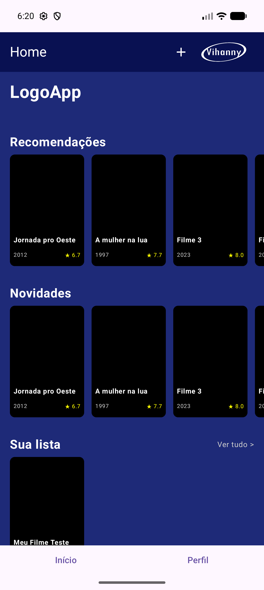
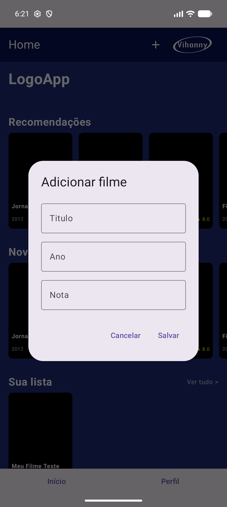
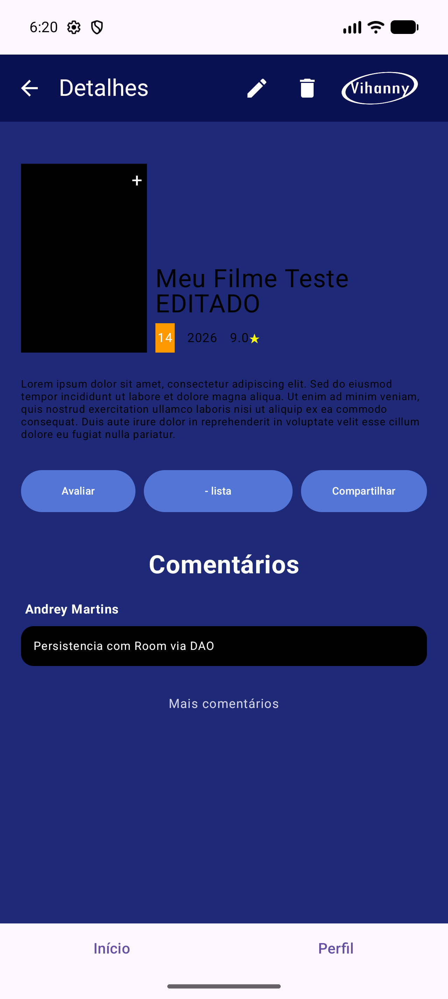
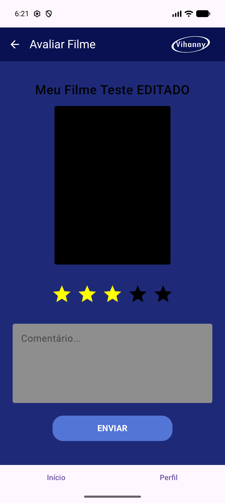
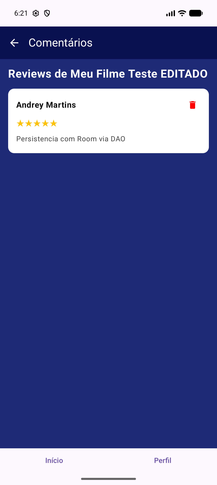
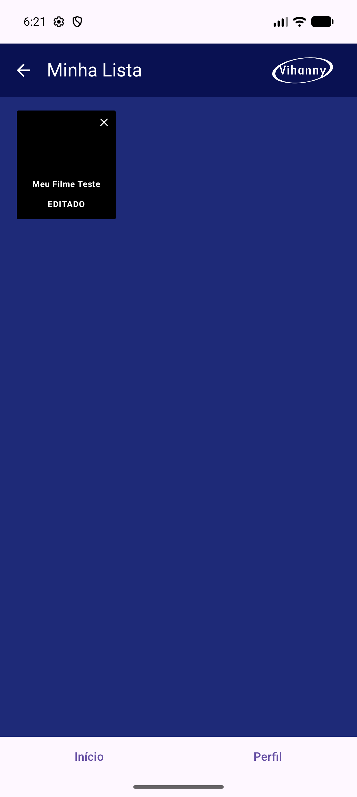
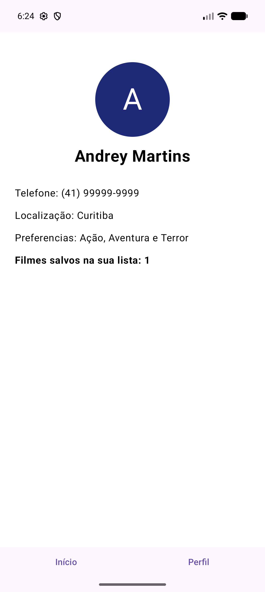

# 📱 myStreaming — Documentação do Projeto Mobile (Terceira Entrega)

> **Trabalho 3 — Persistência de dados com Room.**
> Esta documentação registra a evolução do aplicativo e, principalmente, as decisões do trio
> para trocar a persistência em memória pelo **Room** (a camada oficial do Android sobre o SQLite).

---

## 📖 Índice

1. [Como rodar o projeto](#-como-rodar-o-projeto)
2. [Do Trabalho 1 ao Trabalho 3: o que mudou](#-do-trabalho-1-ao-trabalho-3-o-que-mudou)
3. [A camada de dados: Entity, DAO e Database](#-a-camada-de-dados-entity-dao-e-database)
4. [Como estruturamos as queries do DAO](#-como-estruturamos-as-queries-do-dao)
5. [Como o app conversa com o banco](#-como-o-app-conversa-com-o-banco)
6. [O CRUD completo, tela por tela](#-o-crud-completo-tela-por-tela)
7. [A dificuldade de migrar de `mutableStateListOf` para Room](#-a-dificuldade-de-migrar-de-mutablestatelistof-para-room)
8. [Prova de persistência (teste de aceitação)](#-prova-de-persistência-teste-de-aceitação)
9. [Dificuldades de cada integrante](#-dificuldades-de-cada-integrante)
10. [Checklist de entrega](#-checklist-de-entrega)
11. [Histórico das entregas anteriores](#-histórico-das-entregas-anteriores)

---

## 🚀 Como rodar o projeto

**Requisitos:** Android Studio (Ladybug+), JDK 17 ou superior, Android SDK 35+ (o projeto usa `compileSdk 37`),
emulador ou aparelho com **API 29+**.

```bash
# 1. Sincronizar o Gradle e compilar
./gradlew.bat :app:assembleDebug      # Windows
./gradlew :app:assembleDebug          # Linux/macOS

# 2. Instalar no dispositivo
adb install -r app/build/outputs/apk/debug/app-debug.apk

# 3. Abrir
adb shell am start -n com.example.mystreaming/.MainActivity
```

Ou, simplesmente, abra a pasta no **Android Studio**, clique em *Sync Now* e depois em **Run ▶**.

> ⚠️ O banco `mystreaming.db` fica no armazenamento interno do app. Para começar do zero:
> `adb shell pm clear com.example.mystreaming` (isso **apaga** o banco).
> Para provar a persistência, use `adb shell am force-stop com.example.mystreaming` — que apenas fecha o app.

---

## 📈 Do Trabalho 1 ao Trabalho 3: o que mudou

| | **Trabalho 1** | **Trabalho 2** | **Trabalho 3 (agora)** |
|---|---|---|---|
| Navegação | "de mentirinha", sem `NavHost` | `NavHost` real, rotas e `BottomBar` | `NavHost` real **passando apenas o `id`** do item |
| Dados | listas fixas no código | `mutableStateListOf` / `MutableStateFlow` em memória | **Room (SQLite)** com DAO e Entities |
| Sobrevive ao fechar o app? | ❌ | ❌ | ✅ |
| Adicionar / Editar / Remover | ❌ | ✅ só em memória | ✅ **no banco de verdade** |
| Tela de Detalhes | recebe o objeto pronto | recebe o objeto pronto | **busca o objeto no banco pelo `id`** |

**O que o Trabalho 2 deixou pra trás:** a "Sua Lista" vivia em um `MutableStateFlow` dentro do `MainViewModel`.
Funcionava enquanto o app estava aberto, mas um `MutableStateFlow` **não sobrevive ao destruction da Activity**:
fechava o app e tudo sumia. Pior, a tela de Detalhes recebia o objeto `MediaItem` **inteiro** pela navegação,
o que impedia a tela de buscar o dado fresco no banco.

**O que fizemos neste trabalho:**

1. Criamos a camada de dados `data/` com **2 Entities, 2 DAOs e o `AppDatabase`** (Room).
2. O `MainViewModel` virou `AndroidViewModel`: ele deixou de *guardar* os dados e passou a **refletir o banco**.
3. Todas as telas passaram a **buscar no banco ao abrir** (`LaunchedEffect(Unit)` + `Dispatchers.IO`).
4. A navegação passou a carregar **só o `id`** — a Tela de Detalhes agora busca o filme no banco pelo id.
5. Adicionar, editar e remover passaram a gravar de verdade no SQLite.

> 💡 O `StateFlow` **continua existindo** no `MainViewModel` — mas ele deixou de ser a fonte da verdade
> e virou apenas o "espelho" do banco. Isso manteve o padrão reativo do Trabalho 2 (a UI continua
> atualizando sozinha) sem nenhum estado duplicado.

---

## 🗄️ A camada de dados: Entity, DAO e Database

Todos os arquivos novos ficaram no pacote `com.example.mystreaming.data`:

```
app/src/main/java/com/example/mystreaming/data/
├── MediaItem.kt        @Entity(tableName = "filmes")
├── Review.kt           @Entity(tableName = "reviews")
├── FilmesDao.kt        @Dao  (filmes)
├── ReviewsDao.kt       @Dao  (reviews)
├── AppDatabase.kt      @Database(entities = [...], version = 1)  — Singleton
└── DadosDeExemplo.kt   seed dos dados de exemplo (inseridos pelos próprios DAOs)
```

### 🎬 Entity 1 — `MediaItem` (tabela `filmes`)

```kotlin
@Entity(tableName = "filmes")
data class MediaItem(
    @PrimaryKey(autoGenerate = true) val id: Int = 0,
    val title: String,
    val year: String,
    val rating: String,
    val naMinhaLista: Boolean = false
)
```

**Por que estes campos?**

- `id` — `Int` com `@PrimaryKey(autoGenerate = true)` e default `0`, como pede o enunciado. O `0` faz o
  SQLite gerar o id automaticamente (1, 2, 3, 4...). É a diferença mais importante em relação ao
  Trabalho 2, em que o id era escrito à mão (`MediaItem(1, "Jornada pro Oeste", ...)`).
- `title`, `year`, `rating` — **os mesmos campos da data class do Trabalho 2**. Reaproveitamos a classe
  em vez de inventar outra, para não precisar mexer em nada na interface. O `rating` continua `String`
  para não quebrar o `"★ ${item.rating}"` que já existia na `HomeScreen`.
- `naMinhaLista` — **a única coluna nova**. É a solução que escolhemos para a "Sua Lista": em vez de criar
  uma terceira tabela de junção (`filmes` + `minha_lista`), guardamos uma flag na própria tabela.
  A lista do usuário passa a ser uma **consulta filtrada** (`WHERE naMinhaLista = 1`).
  *Trade-off:* o "Meu Filme" aparece também nas seções "Recomendações"/"Novidades" (ele existe no catálogo).
  Em troca, o modelo continua simples e a listagem fica em uma query só.

### 💬 Entity 2 — `Review` (tabela `reviews`)

```kotlin
@Entity(
    tableName = "reviews",
    foreignKeys = [
        ForeignKey(
            entity = MediaItem::class,
            parentColumns = ["id"],
            childColumns = ["filmeId"],
            onDelete = ForeignKey.CASCADE
        )
    ],
    indices = [Index("filmeId")]
)
data class Review(
    @PrimaryKey(autoGenerate = true) val id: Int = 0,
    val filmeId: Int,
    val usuario: String,
    val comentario: String,
    val nota: Int
)
```

**Por que estes campos?**

- Reaproveita a `data class Review` que **vivia dentro da `HomeScreen.kt`** no Trabalho 2 — agora ela é uma
  Entity de verdade, com os mesmos campos que a UI já usava.
- `filmeId` — **chave estrangeira** para `filmes.id`. Apagar um filme apaga as avaliações dele (`CASCADE`),
  evitando avaliação órfã apontando para um id que não existe mais. O `Index("filmeId")` deixa a consulta
  "comentários de um filme" rápida.
- `nota: Int` — continua 1..5 (as estrelas da tela "Avaliar").
- `usuario: String` — antes era um nome fixo na tela; agora cada avaliação **guarda o autor** no momento
  em que foi criada.

### 🗄️ `AppDatabase` — Singleton

```kotlin
@Database(entities = [MediaItem::class, Review::class], version = 1, exportSchema = false)
abstract class AppDatabase : RoomDatabase() {

    abstract fun filmesDao(): FilmesDao
    abstract fun reviewsDao(): ReviewsDao

    companion object {
        @Volatile
        private var INSTANCE: AppDatabase? = null

        fun getInstance(context: Context): AppDatabase {
            return INSTANCE ?: synchronized(this) {
                INSTANCE ?: Room.databaseBuilder(
                    context.applicationContext,
                    AppDatabase::class.java,
                    "mystreaming.db"
                ).build().also { INSTANCE = it }
            }
        }
    }
}
```

O padrão **Singleton** (`companion object` + `@Volatile` + `synchronized`) garante uma única instância do
banco em todo o app — abrir o banco duas vezes causa problema de lock no SQLite.

### ⚙️ Uma nota sobre a versão do Room

O enunciado cita `room-runtime`, `room-ktx` e `ksp("androidx.room:room-compiler:...")`.
Usamos a **versão atual** do Room, que passou a se chamar **Room 3**:

```kotlin
// app/build.gradle.kts
plugins {
    alias(libs.plugins.android.application)
    alias(libs.plugins.compose.compiler)
    id("com.google.devtools.ksp")                     // sincronizado ANTES do ksp(...)
}

dependencies {
    val room_version = "3.0.3"
    implementation("androidx.room3:room3-runtime:$room_version")
    ksp("androidx.room3:room3-compiler:$room_version")
}
```

No Room 3 o artefato `room3-ktx` **não existe mais**: o conteúdo do `-ktx` foi incorporado no
`room3-runtime` (é ele que traz as extensões de corrotina) e o Room passou a ser multi-plataforma.
A **API é a mesma** do Room 2 — só muda o pacote dos imports (`androidx.room3.*` em vez de `androidx.room.*`).
Tudo aqui (`@Entity`, `@PrimaryKey(autoGenerate = true)`, `@Dao`, `@Insert`, `@Query`, `@Update`, `@Delete`,
`@Database`, `Room.databaseBuilder(...).build()`) continua exatamente igual ao exemplo corrigido em aula.

---

## 🔍 Como estruturamos as queries do DAO

Os dois DAOs têm **os 4 métodos básicos**, todos `suspend fun` (para poderem ser chamados dentro de uma
corrotina sem travar a thread principal):

| Método | `FilmesDao` | `ReviewsDao` |
|---|---|---|
| `@Insert` | `inserir(filme): Long` | `inserir(review): Long` |
| `@Query` | `buscarTodos(): List<MediaItem>` | `buscarTodos(): List<Review>` |
| `@Update` | `atualizar(filme)` | `atualizar(review)` |
| `@Delete` | `deletar(filme)` | `deletar(review)` |

E as **consultas filtradas** que o enunciado pede (além do `buscarTodos()`):

```kotlin
// FilmesDao
@Query("SELECT * FROM filmes WHERE id = :id")            suspend fun buscarPorId(id: Int): MediaItem?
@Query("SELECT * FROM filmes WHERE naMinhaLista = 1 ORDER BY id") suspend fun buscarDaMinhaLista(): List<MediaItem>

// ReviewsDao
@Query("SELECT * FROM reviews WHERE id = :id")           suspend fun buscarPorId(id: Int): Review?
@Query("SELECT * FROM reviews WHERE filmeId = :filmeId ORDER BY id") suspend fun buscarPorFilme(filmeId: Int): List<Review>
```

**Decisões que tomamos:**

- **`ORDER BY id` em todas as leituras.** O SQLite não garante ordem de retorno sem `ORDER BY` — sem isso a
  lista podia "embaralhar" entre uma abertura e outra.
- **`buscarPorId` retorna nullable** (`MediaItem?` / `Review?`). O id pode ter sumido (filme excluído),
  e a tela trata o `null` mostrando "não encontrado" em vez de quebrar.
- **Nome em português**, igual ao resto do projeto (`buscarTodos`, `inserir`, `atualizar`, `deletar`).
- **Uma query por necessidade real**, e não porsporta: só criamos filtro quando a tela precisava dele.

---

## ⚡ Como o app conversa com o banco

O padrão usado em **todas** as telas é o mesmo (e é o que o enunciado pede):

```kotlin
// qualquer @Composable
val scope = rememberCoroutineScope()

LaunchedEffect(Unit) {                 // busca os dados assim que a tela abre
    scope.launch(Dispatchers.IO) {      // fora da thread principal
        try {
            mainViewModel.carregarFilmes()   // -> dao.buscarTodos()
        } catch (e: Exception) {
            Log.e("HomeScreen", "Erro ao carregar os filmes do banco", e)   // tratamento de erro
        }
    }
}
```

E nas telas de detalhe, onde a tela precisa do valor devolvido:

```kotlin
var filme by remember { mutableStateOf<MediaItem?>(null) }

LaunchedEffect(filmeId) {              // <- §3.3 do enunciado: busca pelo id que veio da navegação
    scope.launch(Dispatchers.IO) {
        try {
            val f = mainViewModel.buscarFilmePorId(filmeId)   // -> dao.buscarPorId(id)
            withContext(Dispatchers.Main) { filme = f }
        } catch (e: Exception) {
            Log.e("DetalhesScreen", "Erro ao buscar o filme $filmeId no banco", e)
        }
    }
}
```

> Nenhuma chamada de DAO acontece na thread principal, e todas as operações estão dentro de
> `try/catch` com `Log.e(...)`.

---

## ✅ O CRUD completo, tela por tela

| Operação | Método do DAO | Onde o usuário faz isso |
|---|---|---|
| **Inserir** | `filmesDao.inserir` | Home → botão **＋** na TopAppBar → diálogo *Adicionar filme* (título, ano, nota) → *Salvar* |
| **Inserir** | `reviewsDao.inserir` | Detalhes → *Avaliar* → estrelas + comentário → **ENVIAR** |
| **Atualizar** | `filmesDao.atualizar` | Detalhes → **✏️** → editar título/ano/nota → *Salvar* |
| **Atualizar** | `filmesDao.atualizar` (flag) | Detalhes → *+ lista* / *− lista*; Minha Lista → **✕** |
| **Atualizar** | `reviewsDao.atualizar` | Tela do Comentário → **✏️** → editar texto e nota → *Salvar* |
| **Remover** | `reviewsDao.deletar` | Tela de Comentários → **🗑** no card; Tela do Comentário → **🗑** |
| **Remover** | `filmesDao.deletar` | Detalhes → **🗑** → confirmação → *Excluir* |
| **Buscar (lista)** | `filmesDao.buscarTodos` | Home, ao abrir a tela |
| **Buscar (filtro)** | `filmesDao.buscarDaMinhaLista` | Home ("Sua lista") e tela *Minha Lista* |
| **Buscar (por id)** | `filmesDao.buscarPorId` | **Tela de Detalhes** (§3.3) |
| **Buscar (por id)** | `reviewsDao.buscarPorId` | Tela de Comentário Detalhado |
| **Buscar (por campo)** | `reviewsDao.buscarPorFilme` | Tela de Comentários (comentários de um filme) |

> ⚠️ Os diálogos (adicionar/editar) são **diálogos dentro das telas que já existiam** — o enunciado pede
> que não criássemos telas novas, e um `AlertDialog` do Material 3 não é uma tela nova: é um componente
> sobre a tela atual. Ele existe para que **todas** as operações de CRUD tenham um caminho real na interface
> (e para a apresentação ao vivo).

### 📸 Telas

**Home — as seções e a "Sua lista" vêm do banco**



**Adicionar filme (INSERT)**



**Detalhes — o filme foi buscado no banco pelo id que veio da navegação**



**Avaliar — o formulário grava a avaliação no banco**



**Comentários — lista vinda de `buscarPorFilme(filmeId)`, com botão de excluir**



**Minha Lista — grid do banco, com ✕ para tirar o filme da lista**



**Perfil — a estatística vem do banco (`minhaLista.size`)**



---

## 😤 A dificuldade de migrar de `mutableStateListOf` para Room

O que **quebrou** no caminho — e como resolvemos:

**1. O `id` deixou de ser manual e os dados "de exemplo" pararam de bater.**
No Trabalho 2, o id era escrito à mão: `MediaItem(1, "Jornada pro Oeste", ...)`, e as avaliações guardavam
`filmeId = 1` e `filmeId = 2` apontando para esses ids fixos. Quando o `id` passou a ser gerado pelo
banco (`autoGenerate = true`), nada garantia mais que o primeiro filme inserido tivesse id 1 — e as
avaliações do exemplo passaram a apontar para filmes que não existiam.
*Como resolvemos:* o seed (`DadosDeExemplo.kt`) insere os filmes **com `id = 0`**, e o banco gera 1, 2, 3, 4
na ordem da inserção. Os `filmeId` do seed continuam válidos, e o seed só roda quando a tabela está vazia
(`if (filmesDao.buscarTodos().isEmpty())`), então nunca duplica.

**2. `StateFlow` e banco:dá para ter os dois?**
A primeira tentativa era deixar a lista no `StateFlow` e só "espelhar" no banco. Isso gerava dois estados
podendo divergir (a tela mostrava uma coisa e o banco outra).
*Como resolvemos:* o `StateFlow` virou **derivado** do banco. Cada escrita faz `dao.inserir/atualizar/deletar`
e **recarrega** o fluxo a partir do DAO. Assim existe uma única fonte da verdade — o banco — e o `StateFlow`
é só a ponte para a reatividade do Compose.

**3. A navegação levava o objeto inteiro.**
A tela de Detalhes recebia `filme: MediaItem` pronto, o que impedia a tela de buscar o dado fresco no banco
(o enunciado pede exatamente isso na §3.3).
*Como resolvemos:* as rotas passaram a ter argumento (`descricao/{filmeId}`) e a tela busca por id.
De brinde, a navegação ficou menor e a tela sobrevive ao *process death* do Android.

**4. `MutableStateListOf` com ids fixos não tinha "@Update" nem "@Delete" de verdade.**
Remover um item da lista no Trabalho 2 era só tirar da coleção. Com o banco, "tirar da Minha Lista" é um
`@Update` (mudar a flag) e "remover o filme" é um `@Delete` — são ações diferentes, e separ-las deixou a
interface mais honesta.

**5. A tela de Comentário Detalhado também recebia o objeto pronto.**
Mesma solução: rota `comentario_detalhes/{reviewId}` + `dao.buscarPorId(reviewId)`.

**6. Detalhe chato: `Order` do SQLite.**
Sem `ORDER BY id` a lista de comentários podia aparecer em ordens diferentes entre aberturas. Resolvido
adicionando `ORDER BY id` em todas as leituras.

---

## 🧪 Prova de persistência (teste de aceitação)

O roteiro da apresentação ao vivo:

1. Abrir o app → Home mostra "Recomendações"/"Novidades" vindas do banco.
2. Tocar no **＋** → adicionar um filme novo (*Meu Filme Teste*, 2026, 9.0) → ele aparece na "Sua lista".
3. Entrar no filme → **✏️** → editar o título → *Salvar* → o título muda na lista.
4. *Avaliar* → 4 estrelas + comentário → **ENVIAR** → o comentário aparece em "Comentários".
5. **Fechar o app completamente** e reabrir:
   ```bash
   adb shell am force-stop com.example.mystreaming     # encerra o app
   adb shell monkey -p com.example.mystreaming 1       # reabre
   ```
6. O filme adicionado, o **título editado** e o **comentário salvo continuam lá**. ✅
7. Remover o filme (**🗑**) → ele some da lista de verdade.

**Prints do resultado (após reabrir o app):** o filme continua na "Sua lista" (`docs/01`), a tela de
Detalhes mostra o título editado e o comentário salvo (`docs/03`), e a tela de Comentários mostra a
avaliação vinda do banco (`docs/05`).

> 🎥 **Vídeo:** gravar um vídeo curto (1–2 min) mostrando exatamente esse roteiro — especialmente o
> `force-stop` e a reabertura. É esse vídeo que prova a persistência na apresentação.

---

## 👥 Dificuldades de cada integrante

> *Espaço para o trio preencher com as histórias reais de cada um — este é o item que só o grupo
> consegue responder com as palavras de vocês.*

- **Integrante 1:** *(preencher)*
- **Integrante 2:** *(preencher)*
- **Integrante 3:** *(preencher)*

---

## 📋 Checklist de entrega

- [x] Dependências do Room configuradas (KSP sincronizado **antes** do `ksp(...)`) e o projeto compila sem erro
- [x] 2 `@Entity` (`filmes`, `reviews`) com `@PrimaryKey(autoGenerate = true)`
- [x] 2 interfaces `@Dao` com `@Insert`, `@Query`, `@Update` e `@Delete` — todos `suspend fun`
- [x] Consultas filtradas por campo (`buscarPorId` nos dois DAOs, `buscarPorFilme` e `buscarDaMinhaLista`)
- [x] `AppDatabase` em padrão Singleton (`companion object` + `@Volatile` + `synchronized`)
- [x] As listas buscam os dados do banco ao abrir a tela (`LaunchedEffect(Unit)`)
- [x] Adicionar item pela UI salva de verdade no banco
- [x] Editar item pela UI funciona de verdade e persiste
- [x] Remover item pela UI apaga de verdade do banco
- [x] Tela de Detalhes busca o item **direto do banco pelo id** (§3.3)
- [x] Toda operação de banco dentro de `CoroutineScope(Dispatchers.IO).launch { }`
- [x] Tratamento de erro com `try/catch` + `Log.e(...)`
- [x] Teste de aceitação: adicionar → fechar o app → reabrir → o item continua lá
- [ ] Gravar o vídeo do teste de persistência e anexar ao README
- [ ] Preencher a seção "Dificuldades de cada integrante"
- [ ] Criar o **novo repositório** no GitHub e publicar este código + o README

---

## 📚 Histórico das entregas anteriores

<details>
<summary><b>Trabalho 2 — telas, navegação e estado reativo (clique para abrir)</b></summary>

No **Trabalho 1** tínhamos 3 telas estáticas (`HomeScreen`, `DetalhesFilme`, `Review`), navegação "de
mentirinha" e dados fixos. No **Trabalho 2** refatoramos para:

- **4 telas novas**: Lista de Comentários, Comentário Detalhado, Perfil e Minha Lista (grid).
- **Navegação global** com `NavHost`, `TopBar` e `BottomBar` persistentes.
- **`MainViewModel` compartilhado** entre as telas, com `StateFlow`/`mutableStateOf`.
- **Padronização visual** de cards, botões, cores e tipografia.

> 🖼️ Lista de Comentários
> 
> 🖼️ Comentário Detalhado
> 
> 🖼️ Perfil
> 
> 🖼️ Minha Lista
> 

</details>

---

<div align="center">

**myStreaming — Trabalho 3 · Persistência com Room**

</div>
